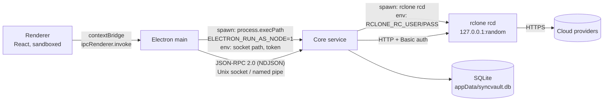

# Architecture

## Components

| Component     | Location                              | Runs as                                                      | Owns                                                                      |
| ------------- | ------------------------------------- | ------------------------------------------------------------ | ------------------------------------------------------------------------- |
| Renderer      | `apps/desktop/src/renderer`           | Chromium renderer (sandboxed, no Node)                       | React UI, i18n strings, theme                                             |
| Preload       | `apps/desktop/src/preload`            | Sandboxed preload                                            | `window.syncvault` — a tiny typed bridge                                  |
| Electron main | `apps/desktop/src/main`               | Electron main process                                        | Windows, tray, single-instance lock, core supervision, request validation |
| Core service  | `packages/core`                       | Child process: Electron binary with `ELECTRON_RUN_AS_NODE=1` | JSON-RPC server, rclone lifecycle, SQLite, job queue, watchers            |
| Shared        | `packages/shared`                     | Library                                                      | Types, zod schemas, RPC method table                                      |
| rclone        | `resources/rclone/<platform>-<arch>/` | Child process of core (`rclone rcd`)                         | Cloud APIs, crypt encryption, bisync                                      |
| Vault (Rust)  | `crates/vault`                        | Native addon (future)                                        | Argon2id, in-memory keys, OS keychain                                     |

## Processes

Lifecycle:

1. Main takes the single-instance lock. A second launch only focuses the existing window.
2. Main generates a random socket/pipe name and a random 256-bit auth token, then spawns the core.
3. Core removes a stale socket file (left by a crash), listens (dir `0700`, socket `0600`), opens the DB,
   prints `SYNCVAULT_CORE_READY` on stdout and starts rclone in the background.
4. Core kills a stale rclone left by a previous crash (PID file + `/proc` cmdline check on Linux), picks a free
   port and random credentials, starts `rclone rcd --config <appData>/rclone/rclone.conf` and polls `rc/noop`
   until it answers, then calls `core/version`.
5. Main connects, authenticates with `auth.hello`, and reports `connected` to the renderer.
6. If the core exits unexpectedly, main restarts it with exponential backoff (max 5 attempts) and shows the
   error in the UI.
7. Quit: main calls `core.shutdown`; the core calls rclone `core/quit` (SIGTERM / SIGKILL fallback), closes the
   DB and exits. Main kills the core if it does not exit in time. If main dies, the core sees stdin EOF and
   shuts down, so no orphaned rclone remains.

## IPC

- Renderer → main: `ipcRenderer.invoke('syncvault:rpc', method, params)`. Main checks the sender frame,
  checks the method against `RENDERER_ALLOWED_METHODS`, validates params with zod, forwards, and validates the
  result with zod before returning it.
- Main → core: JSON-RPC 2.0, one JSON object per line. Max 1 MiB per message. The first request on every
  connection must be `auth.hello { token }` (constant-time compare); anything else closes the connection.
- Core → rclone: `POST http://127.0.0.1:<port>/<group>/<method>` with JSON body and HTTP Basic auth.
- Main → renderer events: `syncvault:core-state` (`starting | connected | restarting | failed | stopped`).
- Renderer-allowed RPC methods: `status.get` (versions, rclone + DB state), `history.list { limit? }`
  (Activity page, newest first), `accounts.list` and `files.list { accountId, path }` (Files page, read-only).
  - `history.list` returns only the folder **name**, never the full local path, and never the free-text `detail` column.
  - `accounts.list` never returns the internal rclone remote name.
  - `files.list`: the renderer sends an **account id**, never an rclone remote; the core looks the remote up in
    SQLite, so the renderer can't make rclone list the local disk. `path` is relative and `/`-separated
    (`isSafeRemotePath`: no `..`, no leading `/`, no `\`). Paths inside an **encrypted** sync folder return
    `{ state: 'encrypted' }` (ciphertext names) until the vault exists. Errors are reason codes, never raw rclone
    messages (they can contain paths). Listings are capped at `FILES_MAX_ENTRIES`.

## Data flow (planned)

File change → chokidar watcher → debounce (3 s) → job enqueued in SQLite → per-folder lock → dry run
(count deletes; pause above 50) → `sync/bisync` with backup dirs and `--max-delete` → history row.

## Where keys and secrets live

| Secret                         | Where                                                                                              |
| ------------------------------ | -------------------------------------------------------------------------------------------------- |
| Master password                | Memory only (vault crate), never on disk                                                           |
| Derived keys (Argon2id)        | Memory only                                                                                        |
| Wrapped vault key              | OS keychain                                                                                        |
| rclone.conf password           | Derived by the vault / OS keychain; passed via `RCLONE_CONFIG_PASS` or `--password-command` (TODO) |
| Cloud OAuth tokens, crypt keys | Inside rclone.conf — which must be encrypted (TODO, see SECURITY.md)                               |
| RPC auth token                 | Memory + core env at spawn time; new on every start                                                |
| rclone rc user/password        | Memory + rclone env at spawn time; new on every start                                              |

## Paths

- App data: Electron `app.getPath('userData')` (Linux: `~/.config/Syncvault`).
- rclone config: `<appData>/rclone/rclone.conf` (Syncvault's own; never the user's).
- Database: `<appData>/syncvault.db`.
- Socket: `$XDG_RUNTIME_DIR/syncvault/core.sock` (Linux), `<appData>/run/core.sock` (macOS / fallback),
  `\\.\pipe\syncvault-<random>` (Windows).
- Resources: resolved only in `apps/desktop/src/main/paths.ts` (dev → repo paths; packaged →
  `process.resourcesPath`, populated by electron-builder `extraResources`).
